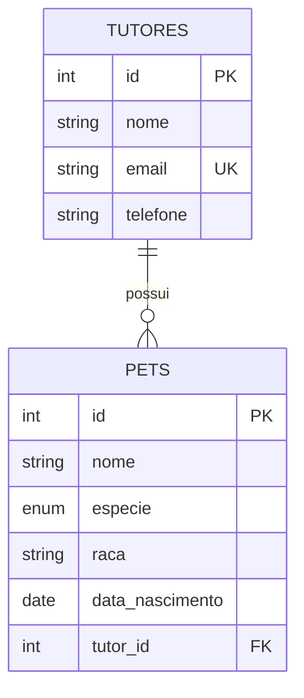

# Modelo de dados

O banco tem duas tabelas: `tutores` e `pets`. Um tutor tem vários pets (1:N) e cada pet pertence a exatamente um tutor.



## Tabela `tutores`

| Coluna | Tipo | Obrigatória | Regras |
|---|---|---|---|
| `id` | inteiro | sim | chave primária, gerada pelo banco |
| `nome` | texto (100) | sim | de 1 a 100 caracteres |
| `email` | texto (120) | sim | formato de e-mail válido; **único** e indexado |
| `telefone` | texto (20) | não | até 20 caracteres |

## Tabela `pets`

| Coluna | Tipo | Obrigatória | Regras |
|---|---|---|---|
| `id` | inteiro | sim | chave primária, gerada pelo banco |
| `nome` | texto (80) | sim | de 1 a 80 caracteres |
| `especie` | enum | sim | `cachorro`, `gato` ou `outro` |
| `raca` | texto (60) | não | até 60 caracteres |
| `data_nascimento` | data | não | formato `AAAA-MM-DD` |
| `tutor_id` | inteiro | sim | chave estrangeira para `tutores.id` |

:::warning[Exclusão em cascata]
O relacionamento usa `cascade="all, delete-orphan"`. Excluir um tutor apaga **todos os pets dele** sem pedir confirmação.
:::

## Como as tabelas são declaradas

As tabelas são classes Python do SQLAlchemy. O atributo `pets` não é coluna: é um atalho para acessar os pets de um tutor (`tutor.pets`).

```python title="app/models/entities.py" {7-9}
class Tutor(Base):
    __tablename__ = "tutores"

    id: Mapped[int] = mapped_column(primary_key=True)
    nome: Mapped[str] = mapped_column(String(100))
    email: Mapped[str] = mapped_column(String(120), unique=True, index=True)
    pets: Mapped[list["Pet"]] = relationship(
        back_populates="tutor", cascade="all, delete-orphan", lazy="selectin"
    )
```

As tabelas são criadas automaticamente quando o servidor inicia (`Base.metadata.create_all`). Para ver como cadastrar dados nelas pela API, veja os [Primeiros passos](../guia-do-usuario/primeiros-passos.md).
