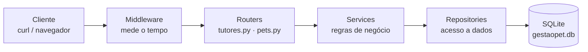
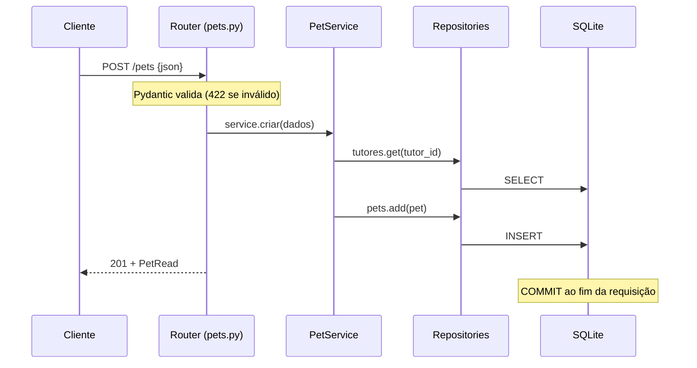

# Visão geral da arquitetura

O GestãoPet é organizado em **camadas**. Cada camada conversa apenas com a camada logo abaixo, o que deixa cada parte simples de ler e de testar.


## Componentes



| Camada | Pasta | Responsabilidade |
|---|---|---|
| Routers | `app/routers/` | Recebem o HTTP, validam o JSON com Pydantic e chamam o serviço |
| Services | `app/services/` | Aplicam as regras (e-mail único, tutor existente). Não conhecem HTTP |
| Repositories | `app/repositories/` | Únicos que falam com o banco, via SQLAlchemy |
| Models | `app/models/` | Descrevem as tabelas `tutores` e `pets` |
| Schemas | `app/schemas/` | Formato de entrada e saída da API (DTOs) |

## Caminho de uma requisição

O diagrama mostra o que acontece em um `POST /pets`:



## Injeção de dependência

Os routers não criam serviços nem repositórios. Eles apenas declaram o que precisam e o FastAPI monta a cadeia `get_db → Repository → Service` a cada requisição:

```python title="app/dependencies.py" {11}
def get_tutor_repository(db: DbSession) -> TutorRepository:
    return TutorRepository(db)


def get_tutor_service(
    repo: Annotated[TutorRepository, Depends(get_tutor_repository)],
) -> TutorService:
    return TutorService(repo)


TutorServiceDep = Annotated[TutorService, Depends(get_tutor_service)]
```

Com isso, um endpoint recebe o serviço pronto só declarando `service: TutorServiceDep`.

:::tip[Vantagem nos testes]
Como o framework monta os objetos, os testes trocam o banco real por um banco em memória com uma única linha: `app.dependency_overrides[get_db] = get_db_teste`.
:::

## Tratamento de erros

Os serviços lançam exceções de domínio, sem saber que existe HTTP. O `app/main.py` traduz cada uma para um código de resposta:

| Exceção | Quando ocorre | Resposta HTTP |
|---|---|---|
| `NaoEncontradoError` | tutor ou pet não existe | 404 Not Found |
| `ConflitoError` | e-mail de tutor já cadastrado | 409 Conflict |
| erro de validação do Pydantic | campo faltando ou inválido | 422 Unprocessable Entity |

Os padrões de projeto usados em cada camada estão em [Padrões de projeto](./padroes-de-projeto.md).
